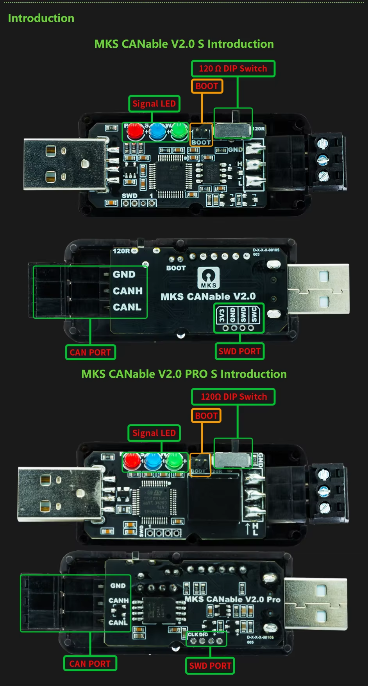
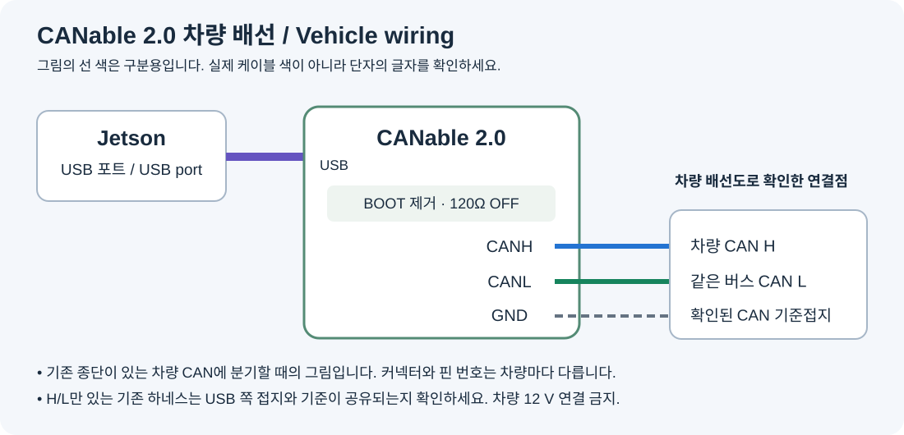

# Install CANable 2.0 from scratch

[Back to supported adapters](indicator-adapters.md)

This guide targets the **standard MKS CANable V2.0 / V2.0 S with STM32G431**, shown at the top of the photograph. Pro, V1.0 and boards with other MCUs are not validated for this release. No soldering is required; prepare suitable CAN wiring and a terminal screwdriver.

## 1. Locate the parts



| Label | Purpose | Normal state |
|---|---|---|
| BOOT | Connect the two pins to enter the firmware loader at power-up | Jumper removed, pins not connected |
| 120Ω / 120R | CAN termination | OFF when tapping an already terminated vehicle bus |
| GND / CANH / CANL | Vehicle terminals | Wire by the actual printed labels |

Open the case to reach BOOT if necessary. SWD is not used. BOOT and the termination switch are separate parts. Determine the switch's ON/OFF position from the actual markings or schematic, not photograph orientation alone.

## 2. Choose an installer

- **[Windows installer ZIP](https://github.com/ajouatom/openpilot/releases/download/carrot-canable-v2/Carrot-CANable-v2-Windows.zip)** — recommended for beginners; Python is not required.
- **[Jetson installer ZIP](https://github.com/ajouatom/openpilot/releases/download/carrot-canable-v2/Carrot-CANable-v2-Jetson.zip)** — use from a Jetson terminal.
- [Firmware binary](https://github.com/ajouatom/openpilot/releases/download/carrot-canable-v2/canable2-carrot-b1-slcan-2.bin) · [Complete firmware source](https://github.com/ajouatom/openpilot/releases/download/carrot-canable-v2/Carrot-CANable-v2-Source.tar.gz)

Both install **carrot-b1-slcan-2**. The tool checks the board's memory layout, backs up the old firmware, programs the image and reads it back for comparison. Moving BOOT and reconnecting USB remain physical steps. Never use an S3 firmware image on CANable.

## 3-A. Install on Windows

1. Download the Windows ZIP and select **Extract All**. Do not run inside the ZIP.
2. Disconnect both vehicle CAN and USB. Connect the **BOOT** jumper, then plug the board into the PC.
3. Run **Install-CANable.exe** and press **보드 확인** (check board). Connect only one target board.
4. Check the box confirming the pictured standard MKS V2.0 board, then press **설치 시작** (install). Keep USB connected through backup, programming and readback. Wait for **설치·검증 완료** (verified) and note the backup directory.
5. Disconnect USB and CAN, remove BOOT, then reconnect USB alone. Press **정상 버전 확인** (verify runtime). Confirm `carrot-b1-slcan-2`.
6. Move the board from the PC to Jetson USB and follow the wiring section.

### Windows driver troubleshooting

The loader may appear as `STM32 BOOTLOADER` or `STM Device in DFU Mode`. If it is detected but cannot be opened, use [official Zadig](https://zadig.akeo.ie/), enable **Options → List All Devices**, and install **WinUSB only for the BOOT device with USB ID 0483:DF11**. Do not select a keyboard, mouse, another USB device, or the normal CANable serial port. Retry the board check afterward.

If the tool rejects the memory layout, stop; do not bypass the check for a similarly named board.

## 3-B. Install on Jetson

Use a terminal on Jetson or an SSH terminal connected to Jetson. Disconnect CAN and USB, connect BOOT, then connect USB to Jetson. Run these commands in order:

```sh
curl -fL https://github.com/ajouatom/openpilot/releases/download/carrot-canable-v2/Carrot-CANable-v2-Jetson.zip -o /tmp/Carrot-CANable-v2.zip
unzip -o /tmp/Carrot-CANable-v2.zip -d /tmp/Carrot-CANable-v2
sudo python3 /tmp/Carrot-CANable-v2/install_canable.py --install --board mks-canable-v2
```

If needed, the tool extracts Jetson's dfu-util package into a separate cache instead of modifying the protected OS. Initial package preparation and download require networking.

After verification, disconnect both USB and CAN, remove BOOT, and reconnect USB first. Before a controller owns the serial port, verify the application with:

```sh
sudo python3 /tmp/Carrot-CANable-v2/install_canable.py --verify-runtime
```

If the controller already owns the port, the tool skips interfering with it. On the Carrot Jetson image, backups remain in `/opt/carrot-jetlink/canable-DATE-…/original.bin`.

## 4. Wire the vehicle connection



With power off, use a verified vehicle connection point. If replacing a working PEAK connection, transfer the same bus's H/L after checking the labels.

```text
Jetson USB ---------------- CANable USB
Verified vehicle CAN H ---- CANable CANH
Same bus CAN L ------------ CANable CANL
Verified CAN reference ---- CANable GND
```

Keep H/L as a short twisted pair and tighten the terminals. GND is the CAN reference. If an existing harness provides only H/L, do not invent another pin: verify the shared reference, including USB power ground, from the wiring documentation. Never connect vehicle 12 V to CANH, CANL or GND.

Keep CANable's 120-ohm termination OFF on an already terminated vehicle bus. A separate bench CAN network needs its own correctly terminated endpoints.

## 5. Use it in Carrot

1. Git Pull the CANable-enabled carrot-wip release and restart comma and Jetson. The normal Jetson update installs the controller and USB access rule.
2. Attach the normal-mode board, with BOOT removed, to Jetson USB. No COM number or MAC address registration is required.
3. The first ready S3, PEAK or CANable with matching CAN data owns output. Several attached adapters do not transmit the same command together.
4. In P, verify the stock stalk, then the remote's left/right controls and the actual exterior lamps. USB enumeration and board LEDs alone do not prove lamp operation.

The current USB control profile is classic CAN at 500 kbit/s, validated on Ioniq 5 PE. Hardware CAN-FD capability does not make this indicator profile universal. The parked verification recorded exactly three flashes per direction, agreeing between comma and CANable feedback; it is not a long-duration driving reliability claim.

## 6. Troubleshooting

| Symptom | Check |
|---|---|
| Still in DFU after removing BOOT | Disconnect USB and CAN for a full power cycle; reconnect USB first. |
| USB works but lamps do not | Vehicle/profile compatibility, correct bus H/L, bitrate, target messages and selected output owner. |
| S3 and USB both connected | The first ready device owns output; failover includes a short delay. |
| Carrot still requests custom firmware | Git Pull cannot move BOOT; install the CANable image using this tool. |
| Programming/readback failure | Keep BOOT selected, check USB and reinstall; retain the backup and logs. |

[Manufacturer](https://github.com/makerbase-mks/CANable-MKS) · [Firmware/build sources](../../../tools/jetlink/canable/README.md) · [한국어](../ko/canable.md)
