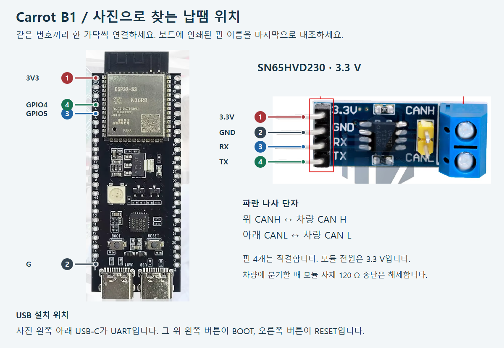

# S3 BLE indicator adapter

[Back to supported adapters](indicator-adapters.md)

Use an ESP32-S3 DevKitC-1 N16R8 and SN65HVD230 3.3 V module. This adapter connects to comma BLE and does not require a Jetson USB CAN adapter for its transport.

**[Photographed build instructions (Korean)](../../../tools/carrot_b1/START.ko.md)** · **[First-install PC ZIP](https://github.com/ajouatom/openpilot/releases/download/carrot-b1-usb-v4/CarrotB1-Starter-v4.zip)**

| S3 | SN65HVD230 | Function |
|---|---|---|
| 3V3 | 3.3V | Supply |
| G | GND | Common ground |
| GPIO4 | TX | Transmit |
| GPIO5 | RX | Receive |

These direct connections apply to the **3.3 V SN65HVD230**, not a 5 V TJA1050. The linked build guide covers USB firmware installation, vehicle H/L, termination and status LEDs.

The BLE name is **Carrot-B1**. A single new matching name/service can enroll automatically while parked; subsequent control authenticates the enrolled board's key. The name alone is not authorization to control an arbitrary board.

Keep the S3 enrollment while using PEAK/CANable too. The first connected adapter with matching CAN data owns output; the others wait. A BLE connection badge does not, by itself, mean S3 currently owns physical indicator output.

[한국어](../ko/s3-can.md)
