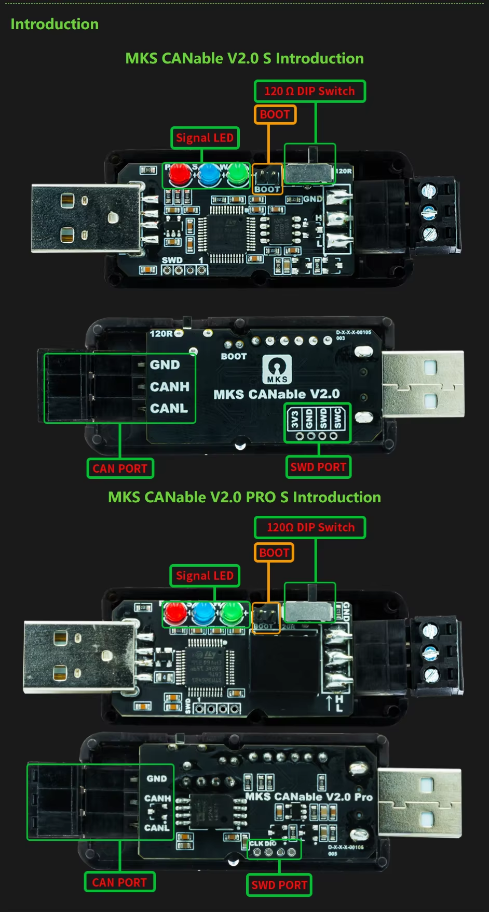
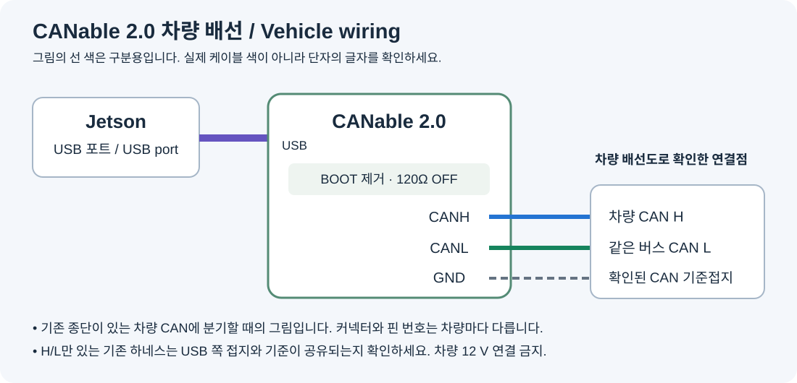

# CANable 2.0 처음 설치하기

[지원 장치 목록으로 돌아가기](indicator-adapters.md)

이 안내는 **MKS CANable V2.0 / V2.0 S 기본형, STM32G431**용입니다. 사진 위쪽 기본형을 기준으로 설명합니다. 아래쪽 Pro 모델, V1.0과 다른 MCU 보드는 이번 배포에서 지원을 확인하지 않았습니다. 납땜은 필요 없으며 차량 CAN H/L에 연결할 전선과 나사를 조일 드라이버가 필요합니다.

## 1. 사진에서 세 곳 찾기



| 사진의 글자 | 하는 일 | 평상시 상태 |
|---|---|---|
| **BOOT** | 펌웨어를 넣는 모드로 시작하는 두 핀 | 점퍼를 제거하여 두 핀이 연결되지 않게 둡니다. |
| **120Ω / 120R** | CAN 선 끝에 사용하는 종단저항 | 이미 종단된 차량 CAN에 분기 연결할 때는 OFF입니다. BOOT와 다른 부품입니다. |
| **GND / CANH / CANL** | 차량 쪽 연결 단자 | 보드에 인쇄된 글자를 기준으로 배선합니다. |

케이스가 있으면 BOOT 점퍼를 만질 수 있도록 먼저 엽니다. **SWD 포트는 이번 설치에서 사용하지 않습니다.** 120Ω 스위치 방향은 제품 표기나 회로도로 확인하세요. 사진의 좌우 방향만으로 ON/OFF를 정하지 않습니다.

## 2. 설치 방법 선택

- **[Windows PC 설치 도구 받기](https://github.com/ajouatom/openpilot/releases/download/carrot-canable-v2/Carrot-CANable-v2-Windows.zip)** — 처음 설치하는 분에게 권장합니다. Python 설치 없이 실행합니다.
- **[젯슨 설치 묶음 받기](https://github.com/ajouatom/openpilot/releases/download/carrot-canable-v2/Carrot-CANable-v2-Jetson.zip)** — 젯슨 터미널에서 설치할 때 사용합니다.
- [펌웨어만 받기](https://github.com/ajouatom/openpilot/releases/download/carrot-canable-v2/canable2-carrot-b1-slcan-2.bin) · [전체 소스 받기](https://github.com/ajouatom/openpilot/releases/download/carrot-canable-v2/Carrot-CANable-v2-Source.tar.gz)

두 방법은 같은 **carrot-b1-slcan-2** 펌웨어를 설치합니다. 도구가 보드 메모리 구성을 확인하고 **기존 펌웨어 백업 → 기록 → 다시 읽어 비교**를 자동으로 처리합니다. BOOT 점퍼를 옮기고 USB를 다시 꽂는 작업은 사람이 해야 합니다. S3용 펌웨어를 CANable에 넣으면 안 됩니다.

## 3-A. Windows PC에서 설치

1. 위 Windows ZIP을 저장하고 **모두 압축 풀기**를 누릅니다. ZIP 안에서 바로 실행하지 않습니다.
2. CANable의 **차량 CAN 선과 USB를 모두 분리**합니다. 사진의 **BOOT 두 핀을 점퍼로 연결**한 뒤 PC USB에 꽂습니다. 120Ω 부품을 BOOT로 착각하지 않도록 보드의 글자를 확인합니다.
3. 압축 푼 폴더에서 **Install-CANable.exe**를 실행하고 **보드 확인**을 누릅니다. 같은 종류의 보드를 여러 개 연결하지 마세요.
4. 사진 위쪽 MKS V2.0 기본형임을 체크하고 **설치 시작**을 누릅니다. 도구가 원본 백업, 펌웨어 기록, 읽기 검증을 마칠 때까지 USB를 유지합니다. **설치·검증 완료** 문구와 백업 폴더 위치를 확인합니다.
5. USB와 CAN 선을 분리하고 **BOOT 점퍼를 제거**합니다. USB만 다시 PC에 꽂은 뒤 **정상 버전 확인**을 누릅니다. `carrot-b1-slcan-2`가 나오면 PC 설치가 끝났습니다.
6. PC에서 빼서 젯슨 USB에 꽂고 아래 차량 배선 단계로 진행합니다.

### Windows에서 보드를 열지 못한다면

BOOT 장치는 장치 관리자에서 `STM32 BOOTLOADER` 또는 `STM Device in DFU Mode`로 보일 수 있습니다. 장치는 보이는데 도구가 열지 못하면 [Zadig 공식 사이트](https://zadig.akeo.ie/)에서 도구를 받아 **Options → List All Devices**를 켜고, **USB ID가 0483:DF11인 BOOT 장치만** 선택하여 **WinUSB**를 설치합니다. 키보드·마우스·다른 USB 장치의 드라이버는 선택하지 않습니다. 완료 후 설치 도구의 보드 확인을 다시 누릅니다. 정상 모드의 CANable 직렬 포트에 WinUSB를 설치하는 절차가 아닙니다.

도구가 지원하지 않는 메모리 구성이라고 표시하면 다른 제품일 수 있으므로 중단합니다. 억지로 검사 조건을 해제하지 마세요.

## 3-B. 젯슨에서 설치

PC 대신 **젯슨 자체 터미널 또는 젯슨에 접속한 SSH 터미널**을 사용합니다. USB와 CAN 선을 빼고 BOOT 점퍼를 연결한 다음 CANable USB만 젯슨에 꽂으세요.

다음 세 줄을 차례로 실행합니다.

```sh
curl -fL https://github.com/ajouatom/openpilot/releases/download/carrot-canable-v2/Carrot-CANable-v2-Jetson.zip -o /tmp/Carrot-CANable-v2.zip
unzip -o /tmp/Carrot-CANable-v2.zip -d /tmp/Carrot-CANable-v2
sudo python3 /tmp/Carrot-CANable-v2/install_canable.py --install --board mks-canable-v2
```

필요하면 도구가 젯슨용 dfu-util을 준비합니다. 보호된 젯슨 이미지에서도 OS를 다시 설치하지 않고 진행하도록 패키지를 별도 폴더에 풉니다. 네트워크는 첫 도구 준비와 ZIP 다운로드에 필요합니다.

**설치·검증 완료**가 나오면 USB와 CAN 선을 모두 잠깐 분리하고 BOOT 점퍼를 제거한 뒤, USB부터 다시 꽂습니다. 아직 제어 프로그램이 장치를 사용하지 않는 상태라면 다음 명령으로 버전을 확인할 수 있습니다.

```sh
sudo python3 /tmp/Carrot-CANable-v2/install_canable.py --verify-runtime
```

이미 제어 프로그램이 사용 중이라는 안내가 나오면 장치를 강제로 닫지 않고 확인을 건너뜁니다. Carrot 젯슨 이미지의 백업은 `/opt/carrot-jetlink/canable-날짜-…/original.bin`에 남습니다.

## 4. 차량 배선



전원을 끄고, 해당 차량에서 확인된 CAN 연결점에 배선합니다. 기존 PEAK에서 사용하던 **동일한 버스의 H/L**을 옮기는 경우에도 글자를 다시 확인합니다.

```text
젯슨 USB ───── CANable USB

확인된 차량 CAN H ───── CANable CANH
같은 버스의 CAN L ───── CANable CANL
확인된 CAN 기준접지 ─── CANable GND
```

H/L은 꼬임선 한 쌍으로 짧게 연결하고 단자 나사를 조입니다. GND는 CAN 기준접지용입니다. 기존 하네스가 H/L 두 선만 제공한다면 임의의 핀을 추가하지 말고, USB 전원 쪽을 포함한 접지 기준이 공유되는지 해당 배선도로 확인하세요. **차량 12 V를 GND·CANH·CANL에 연결하지 않습니다.**

차량의 기존 종단을 유지하고 CANable의 **120Ω은 OFF**로 둡니다. 실험용으로 별도 CAN 버스를 만드는 경우는 차량 분기 배선과 다르며 양 끝의 종단 구성을 따로 맞춰야 합니다.

## 5. Carrot에서 사용

1. CANable 지원이 포함된 carrot-wip을 **Git Pull**하고 콤마와 젯슨을 재시작합니다. 정상 젯슨 업데이트 과정에서 USB 접근 규칙과 제어 코드가 적용됩니다.
2. BOOT 점퍼가 빠진 CANable을 젯슨 USB에 연결합니다. 일반 모드에서는 USB CAN 장치로 자동 탐색합니다. COM 번호나 MAC 주소를 등록하지 않습니다.
3. S3·PEAK·CANable 중 먼저 대상 CAN까지 확인한 장치가 제어를 맡습니다. S3가 먼저 선택된 경우 CANable을 함께 꽂아도 두 장치가 동시에 송신하지 않습니다.
4. P단 정차 상태에서 순정 레버를 먼저 확인하고, 리모컨 좌·우를 시험해 **차량 외부 램프가 정확히 점멸하는지** 확인합니다. 보드 LED나 USB 인식만으로 점등 성공을 판단하지 않습니다.

현재 USB 제어는 아이오닉 5 PE에서 확인한 클래식 CAN 500 kbit/s 프로필입니다. CANable 하드웨어가 CAN-FD를 지원하더라도 이 깜빡이 제어가 모든 CAN-FD 차량에 적용되는 것은 아닙니다. 확인한 실차 시험에서는 좌·우 각각 3회 점멸했고, 콤마와 CANable의 램프 피드백이 일치했습니다. 장시간 주행 신뢰성을 이 한 번의 시험으로 보증하지는 않습니다.

## 6. 자주 막히는 곳

| 증상 | 확인할 내용 |
|---|---|
| BOOT 점퍼를 뺐는데 DFU로 남음 | USB와 CAN을 모두 분리해 전원을 완전히 끈 뒤 USB부터 다시 연결합니다. |
| USB만 인식되고 램프가 안 켜짐 | 지원 차량/프로필, 같은 버스의 H/L, 500 kbit/s, 대상 메시지와 현재 선택된 장치를 확인합니다. |
| S3와 USB를 모두 연결함 | 먼저 준비된 한 장치가 사용됩니다. 장치가 바뀔 때는 짧은 대기 시간이 있습니다. |
| 업데이트 후에도 전용 펌웨어가 필요하다고 표시됨 | Carrot Git Pull은 CANable의 BOOT 점퍼를 대신 움직이지 못합니다. 이 도구로 CANable 펌웨어를 설치하세요. |
| 기록이나 검증 실패 | BOOT 상태를 유지하고 USB 연결을 확인하여 다시 설치합니다. 원본 백업과 로그를 보관합니다. |

[제조사 자료](https://github.com/makerbase-mks/CANable-MKS) · [펌웨어 소스 및 빌드 설명](../../../tools/jetlink/canable/README.md) · [English](../en/canable.md)
