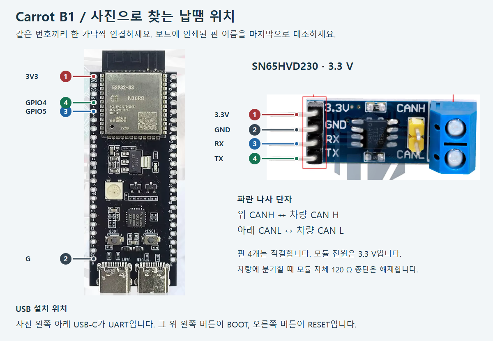

# S3 BLE 깜빡이 장치

[지원 장치 목록으로 돌아가기](indicator-adapters.md)

ESP32-S3 DevKitC-1 N16R8와 SN65HVD230 3.3 V 모듈을 연결하는 방식입니다. S3는 콤마 BLE에 연결되므로 이 통신 경로에 젯슨 USB CAN 어댑터는 필요하지 않습니다.

**[사진을 보며 처음부터 만들기](../../../tools/carrot_b1/START.ko.md)** · **[PC 첫 설치 ZIP](https://github.com/ajouatom/openpilot/releases/download/carrot-b1-usb-v4/CarrotB1-Starter-v4.zip)**

| S3 | SN65HVD230 | 용도 |
|---|---|---|
| 3V3 | 3.3V | 전원 |
| G | GND | 공통 접지 |
| GPIO4 | TX | 송신 |
| GPIO5 | RX | 수신 |

이 표는 **3.3 V SN65HVD230** 기준이며 5 V TJA1050 모듈에 그대로 적용하지 않습니다. 차량 H/L, 종단저항, USB 설치, 상태 LED의 상세 설명은 위 처음 만들기 안내에 있습니다.

BLE 이름은 **Carrot-B1**입니다. 이름과 서비스가 맞는 새 보드가 하나면 정차 상태에서 자동 등록하며, 등록 후 인증 키로 해당 보드를 확인합니다. 이름만 같은 아무 보드에 제어 명령을 보내는 방식은 아닙니다.

S3 등록 정보를 유지한 상태로 PEAK/CANable도 사용할 수 있습니다. 먼저 정상 연결과 대상 CAN을 확인한 장치가 선택되고, 나머지는 대기합니다. BLE 연결 표시가 떠 있다는 것만으로 현재 S3가 선택된 제어 장치라는 뜻은 아닙니다.

[English](../en/s3-can.md)
