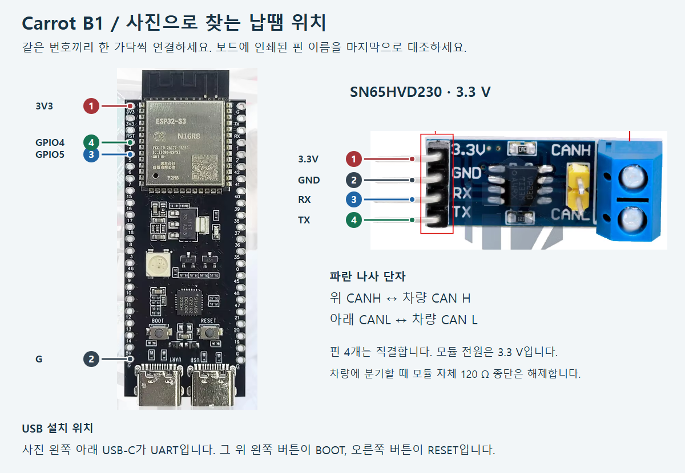

# Carrot B1 처음 만들기

이 안내는 사진과 같은 **ESP32-S3 DevKitC-1 N16R8**(플래시 16 MB)과 **SN65HVD230 3.3 V** 모듈용입니다. PC에서 USB로 프로그램을 한 번 넣은 다음 전선 네 가닥을 납땜합니다. 차량 쪽에는 해당 차종의 방향지시등 CAN H/L이 확인된 커넥터가 필요합니다.

**[초보자용 ZIP 내려받기](https://github.com/ajouatom/openpilot/releases/download/carrot-b1-usb-v4/CarrotB1-Starter-v4.zip)** · **[USB 다운로드 도구 열기](https://espressif.github.io/esptool-js/)**

## 1. 준비물

위 두 보드, 데이터 전송이 되는 USB-C 케이블, Chrome 또는 Edge가 설치된 PC, 짧은 절연 전선 4가닥, 차량 CAN용 꼬임선 한 쌍, 납땜 도구, 절연재, 멀티미터를 준비하세요. 차량에서 S3를 켤 때는 차량용 USB 전원 등 안정된 5 V USB 전원을 사용합니다. 차량 12 V를 보드 핀에 넣으면 보드가 손상됩니다.

## 2. 새 S3에 펌웨어 넣기

1. ZIP을 PC에 저장하고 **모두 압축 풀기**를 누르세요. 폴더에서 **START.html**을 열면 이 안내를 다시 볼 수 있습니다.
2. 차량 배선과 트랜시버를 연결하기 전에 **S3만** PC에 연결하세요. 아래 사진처럼 안테나가 위라면 아래 **왼쪽 UART USB-C**를 사용합니다.
3. PC의 Chrome 또는 Edge에서 [Espressif USB 다운로드 도구](https://espressif.github.io/esptool-js/)를 여세요. 프로그램 설치는 필요 없습니다. 맨 위 **Program** 영역에서 속도 **115200**을 선택하고 **Connect**를 누릅니다. 포트 선택 창에서 방금 꽂은 USB 직렬 포트를 선택합니다. 어느 포트인지 모르겠으면 케이블을 뺐다 다시 꽂아 새로 나타나는 항목을 찾으세요.
4. 연결 로그에 **ESP32-S3**가 표시되는지 확인하세요. 파일 입력 줄이 없으면 **Add File**로 한 줄을 추가합니다. **Flash Address**에 **0x0**(숫자 영)을 넣고 옆 파일 선택 버튼에서 압축 푼 폴더의 **CarrotB1-USB-v4.bin**을 고릅니다. 파일은 하나만 선택합니다. 이 파일에는 새 보드에 필요한 부트로더와 파티션이 포함돼 있습니다.
5. **Erase all**은 끄고 나머지 플래시 옵션은 기본값으로 두세요. **Program**을 누른 뒤 쓰기와 검증이 끝날 때까지 USB를 유지합니다. 오류 없이 완료되면 **Disconnect**를 누르고 S3의 **RESET**을 한 번 누르세요. 차량에 연결하지 않은 보드에서 RGB LED가 **주황색**이면 첫 설치가 끝났습니다.
6. 연결이 멈추면 **BOOT를 누른 채 RESET을 한 번 눌렀다 떼고, BOOT를 놓은 뒤** 다시 Connect 하세요. 포트 자체가 보이지 않으면 데이터 케이블과 UART 포트를 확인하세요. Windows 장치 관리자에 USB 직렬 장치 오류가 뜨고 사진과 같이 CP2102 칩이 달려 있으면 [Silicon Labs 공식 CP210x 드라이버](https://www.silabs.com/developer-tools/usb-to-uart-bridge-vcp-drivers)를 설치합니다. [Espressif 부트 모드 안내](https://docs.espressif.com/projects/esptool/en/latest/esp32s3/advanced-topics/boot-mode-selection.html)

이 USB 파일은 **빈 보드에 처음 설치할 때** 사용합니다. 등록한 보드는 이후 콤마의 carrot-wip Git Pull·재시작 후 BLE 자동 업데이트를 받습니다.

## 3. USB를 뽑고 같은 번호끼리 납땜하기

| 번호 | S3의 인쇄 글자 | 트랜시버의 인쇄 글자 | 용도 |
| --- | --- | --- | --- |
| ① | 3V3 | 3.3V | 모듈 전원 |
| ② | G | GND | 공통 접지 |
| ③ | 5 | RX | S3가 CAN 데이터를 받는 선 |
| ④ | 4 | TX | S3가 깜박이 명령을 보내는 선 |

전선 양끝을 짧게 벗기고 한 가닥씩 납땜하세요. 이 3.3 V 보드는 네 가닥 모두 직결합니다. S3 오른쪽의 TX/RX 글자는 UART 핀이므로 **왼쪽의 숫자 4와 5**를 찾으세요. 다 붙인 뒤 3V3와 G 사이에 납이 이어진 곳이 없는지 확인하고 노출된 선을 절연하세요.

## 4. 차량 CAN 연결과 첫 시험

1. 모듈의 전원과 차량 배선을 모두 분리한 채 멀티미터를 저항(Ω)에 맞추고 파란 단자 두 곳 사이를 재세요. 약 **120 Ω**이면 모듈에 종단저항이 연결된 상태입니다. 이미 양 끝이 종단된 차량 CAN에 분기할 때는 판매처 회로도에서 해당 점퍼나 저항을 확인해 해제하고 다시 재세요. 노란 부품의 모양만으로 판단하지 마세요. [TI 데이터시트](https://www.ti.com/lit/ds/symlink/sn65hvd230.pdf)
2. 차량 전원을 끈 상태에서 차량 배선도로 확인한 **CAN H를 파란 단자 위 CANH**, **같은 버스의 CAN L을 아래 CANL**에 넣고 나사를 조이세요. 차량별 커넥터와 핀 번호는 다릅니다. 차량과 S3 전원의 접지 기준도 확인하세요.
3. 정차 상태에서 콤마 블루투스를 켜고 S3 전원을 넣으세요. 새 보드는 전원 투입 후 3분 동안 **Carrot-B1**으로 자동 등록할 수 있습니다. 여러 대가 보이면 등록할 보드 하나만 켜세요. BLE 제어를 쓰려면 콤마의 별도 **CAN-FD SPAS** 설정은 꺼야 합니다.
4. 대상 CAN이 들어오면 C3/C4의 S3 표시가 초록색이 됩니다. 순정 레버로 좌우가 정상인지 먼저 확인하고, 주차 상태에서 리모컨 좌우를 한 번씩 눌러 실제 차량 램프를 확인하세요.

## 5. S3 보드의 RGB LED 읽기

| 보이는 색과 움직임 | 뜻 |
| --- | --- |
| 주황색 고정 | 전원을 넣을 때 켜집니다. 대상 CAN과 BLE가 모두 없으면 그대로 유지됩니다. |
| 보라색 고정 | BLE가 연결됐고, 대상 CAN 데이터를 기다립니다. |
| 파란색이 서서히 밝아졌다 어두워짐 | 대상 CAN을 찾았고 콤마의 유효한 제어 신호를 기다립니다. 한 주기는 약 2.4초입니다. |
| 초록색 고정 | 대상 CAN을 수신하고 콤마의 유효한 제어 신호도 받고 있습니다. |
| 청록색이 잠깐 켜짐 | S3가 깜박이 명령을 CAN으로 보내는 중입니다. 실제 점등 여부는 차량 램프로 확인합니다. |
| 하늘색에 가까운 청록색 고정 | BLE 펌웨어 업데이트 중이거나 S3가 재부팅을 준비하고 있습니다. |
| 빨간색 | CAN 통신 또는 보드 초기화 오류입니다. 일부 통신 오류는 약 0.5초만 표시됩니다. |

현 펌웨어는 500 kbit/s 클래식 CAN에서 대상 메시지 0x3C1·0x413의 형식과 상태가 맞아야 동작합니다. 앞선 정차 점멸 시험에는 기존 5 V 트랜시버를 사용했습니다. 사진의 3.3 V 모듈을 장착한 실차 시험은 아직 진행하지 않았습니다.
