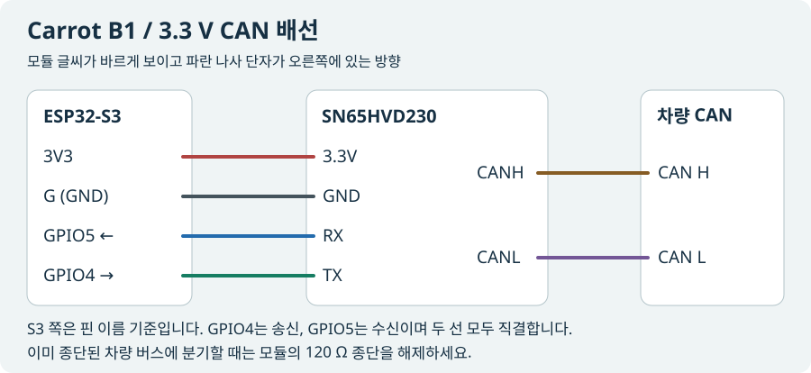

# Carrot B1 조립 · SN65HVD230 배선

[처음 만드는 분 · USB 펌웨어 설치, 사진 배선도, LED 색상표](START.ko.md)

ESP32-S3 DevKitC-1 N16R8과 **SN65HVD230 3.3 V CAN 트랜시버 모듈**을 사용합니다. 이 안내는 왼쪽에 4핀 헤더, 오른쪽에 파란 2단 나사 단자가 있는 보드 기준입니다. 판매 사진에는 부품명이 SN65HV230으로 줄여 쓰이기도 하므로 주문 전 칩 사양과 기판의 3.3V 표기를 확인하세요.

전원과 차량 커넥터를 분리하고 아래 순서로 배선하세요. 기판의 글씨를 바르게 놓았을 때 모듈 헤더는 위에서부터 다음 순서입니다.

| 모듈 단자 | 연결할 곳 | 역할 |
| --- | --- | --- |
| 3.3V | S3의 3V3 | 모듈 전원. 5 V 또는 차량 12 V 연결 금지 |
| GND | S3의 G 또는 GND | 두 보드의 공통 접지 |
| RX | S3의 GPIO5 | 모듈이 받은 CAN 데이터를 S3로 전달 |
| TX | S3의 GPIO4 | S3의 깜박이 명령을 모듈에 전달 |
| CANH (나사 단자 위) | 차량 배선도에서 확인한 대상 버스의 CAN H | CAN 차동 신호 |
| CANL (나사 단자 아래) | 같은 버스의 CAN L | CAN 차동 신호 |

이 3.3 V 모듈에서는 TX와 RX를 각각 **직결**합니다. 기존 5 V TJA1050 조립품을 교체한다면 모듈 전원을 3V3으로 옮기고, GPIO5 쪽에 설치한 1 kΩ 직렬 저항과 1.8 kΩ 접지 저항 또는 레벨 변환 회로를 제거한 뒤 연결하세요. S3에는 USB 등 규격에 맞는 전원을 공급하고, 차량과 공통 접지 기준이 있는지 확인하세요. 모듈의 나사 단자 두 개는 모두 CAN 신호용입니다.

**종단저항 확인.** 차량 버스 중간에 분기할 때는 기존 양 끝의 120 Ω 종단만 사용합니다. 모듈을 전원과 차량에서 완전히 분리한 상태로 CANH와 CANL 사이의 저항을 측정하세요. 약 120 Ω이면 모듈 자체 종단이 걸려 있습니다. 판매처 회로도에서 종단 점퍼인지 고정 저항인지 확인하고 해제한 다음 다시 측정하세요. 노란 부품의 색이나 위치만으로 점퍼 기능을 판단하지 마세요. [TI 데이터시트](https://www.ti.com/lit/ds/symlink/sn65hvd230.pdf)

**첫 작동 확인.** 정차 상태에서 블루투스를 켠 콤마 가까이에서 S3에 전원을 넣습니다. 새 보드는 처음 3분 동안 Carrot-B1 이름으로 자동 등록할 수 있습니다. C3/C4의 S3 표시가 보라색이면 BLE 연결 후 대상 CAN을 기다리는 중이고, 초록색이면 대상 CAN이 확인된 상태입니다. 순정 레버로 좌우 신호가 정상인지 먼저 확인한 뒤, 주차 상태에서 리모컨 좌우를 한 번씩 눌러 실제 램프와 대조하세요.

현재 펌웨어는 500 kbit/s 클래식 CAN에서 0x3C1과 0x413의 형식·상태가 맞을 때 동작합니다. 차량별 접속 지점은 배선도로 확인해야 합니다. 기존 정차 점멸 시험은 5 V 모듈로 수행했으며, 이 3.3 V 모듈의 실차 점멸은 아직 검증하지 않았습니다.
